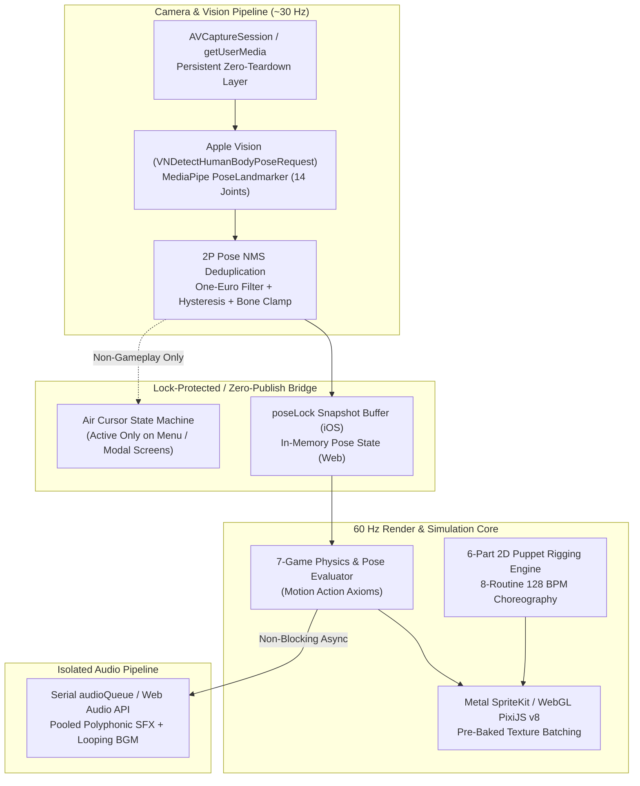

# PangPang Friends — Real-Time Dual-Platform Vision Motion Game Engine

A dual-platform (WebGL + Native iOS Metal) controller-free full-body AR motion game engine engineered for sustained 60fps gameplay over live 1–2 player computer-vision pose tracking. Built without heavy third-party game frameworks, both runtimes share an identical mathematical specification for pose filtering, game physics, procedural 2D skeletal choreography, and low-latency audio synthesis.

---

## 1. System Architecture

The engine decouples computer-vision inference, camera session management, audio synthesis/playback, and GPU frame rendering into isolated execution domains so the 16.6ms (60fps) render budget is never blocked by I/O, decoding, or ML inference.



### Dual-Platform Runtime Parity

| Subsystem | Web Runtime (`src/`) | Native iOS Runtime (`ios/PangPangFriends/`) |
|---|---|---|
| **Renderer** | PixiJS v8 (WebGL, with Canvas 2D fallback) | SpriteKit (Metal-backed `SKScene`) + SwiftUI HUD |
| **Pose Tracking** | MediaPipe PoseLandmarker (`14` upper/lower landmarks) | Apple Vision `VNDetectHumanBodyPoseRequest` (`14` landmarks) |
| **Camera Mapping** | `object-fit: cover` aspect-fill inverse projection | `AVCaptureVideoPreviewLayer (.resizeAspectFill)` + `RotationCoordinator` |
| **Audio Engine** | Web Audio API (`AudioBuffer` cache + synth fallback) | `AVAudioPlayer` reusable voice pool + `AVAudioEngine` synth on `pp.audio.queue` |
| **Character Animation** | `DancePuppetRig` (`src/danceRig.js`, 6-part hierarchy) | `DancePuppetRig` (`GameScene.swift`, 6-part `SKNode` hierarchy) |

---

## 2. Real-Time Computer Vision & Signal Processing

Raw single-frame body-pose estimates exhibit jitter, confidence flicker, occlusion dropouts, and duplicate bounding-box detections in 2-player scenes. The tracking pipeline stabilizes all 14 joints before any gameplay consumer reads them:

1. **Aspect-Fill Coordinate Alignment**: Camera buffers (16:9) are mapped into the exact cropped display viewport (e.g., 19.5:9 iPhone landscape or 16:9 desktop) so hand hitboxes, air cursors, and organic body auras register 1:1 with the physical player.
2. **2-Player Pose NMS Deduplication**: Multi-person observations are ranked by upper-body landmark quality and deduplicated via aspect-corrected center distance, head distance, IoU (`> 0.28`), and containment (`> 0.48`), preventing single-player ghost splits in 2P mode.
3. **One-Euro Adaptive Filtering + Confidence Hysteresis**: Each joint passes through an asymmetric confidence EMA (`enter = 0.28`, `exit = 0.14`, `tauRise = 0.08s`, `tauFall = 0.22s`), an outlier spike gate, `0.45s` torso-relative occlusion persistence, and a true One-Euro filter tuned separately for high-velocity hands vs. stable torso joints.
4. **Anatomical Non-Destructive Bone Clamping & Palm Projection**: Forearm/leg lengths are upper-bound clamped against a dynamically smoothed `torsoH` (derived from hip-to-shoulder distance or shoulder-width fallback for seated/close-up play), and wrist positions are projected `0.28 × forearmLength` onto the visual palm center.
5. **1:1 Dominant-Hand Air Cursor**: Menu navigation uses a single locked dominant hand with `0.12` vertical switch hysteresis, `0.22s` hand-switch hold, `0.0045` micro-deadzone, and nearest-target scoring across exact UI element bounds.

---

## 3. Game Engine Subsystems

### 3.1 Modular 2D Puppet Rigging & 128 BPM Choreography Engine

To replace rigid 2-frame sprite toggling with fluid, beat-synchronized character animation across both PixiJS and SpriteKit, the engine implements a deterministic 7-axiom procedural puppet system (see [`doc/dance_choreography_axioms.md`](doc/dance_choreography_axioms.md)):

- **Hierarchical Joint Tree**: `root -> pelvis -> { legL (-2), legR (-2), armL (-1), armR (-1), body (0), head (+1) }` with deep-tucked normalized shoulder/hip/neck pivots and a ground-projected dynamic shadow sprite that scales inversely with vertical jump height.
- **Volume-Preserving Squash & Stretch**: All landing dips and beat kicks enforce $s_x \cdot s_y = 1.0$ ($s_y = 1 + k \cdot a$, $s_x = 1 / s_y$).
- **Phase-Lag Secondary Motion**: Head and character accessories trail torso beat phase by $\Delta\phi = -0.35\text{ rad}$ to produce soft elastic follow-through without an iterative spring solver.
- **8-Routine Beat-Locked State Machine**: Automatically cycles 8 distinct procedural dance routines (`groove_bounce`, `disco_point`, `cheer_manse`, `wave_surf`, `happy_clap`, `star_jump`, `twist_shimmy`, `hero_pose`) every 6 beats with exponential cross-fade ($\alpha = \min(1, 8 \cdot dt)$) and per-character personality offsets (Dino, Momo, Popo).
- **Energy Modulation & Instant Freeze-Pose Lock**: Real-time player motion scales jump height and limb amplitude (`0.65x–1.30x`). Entering a freeze phase snapshots the exact live joint angles in-place; detected player movement injects a 32 Hz micro-tremor (`±0.06 rad`).
- **Gameplay Mode Reuse**: The same rig drives running/squatting/jumping states in *Jungle Adventure* and counter-lean arm stabilization in *Log Bridge Balance*.

### 3.2 Full-Body Game Suite (7 Modes)

1. **Fruit PangPang** — 90s multi-directional projectile slicing with gravity, elastic fruit-to-fruit & wall collisions, multi-hit HP targets, hitstop, rainbow chain blasts, and a 3-boss relay.
2. **Balloon Volley** — Aerodynamic lift/drag/spin simulation with off-center torque impulses, elastic balloon-to-balloon collisions, and batched soap-bubble VFX.
3. **Freeze Dance (Neon Club)** — 128 BPM rhythm dance with progressive 3-character puppet lineup, laser/mirror-ball/EQ shaders, and EMA motion-threshold freeze detection.
4. **Pose Adventure (Phases 1–4)** — 13 full-body poses (7 classic + 6 expanded: Rabbit, T-Rex, Rocket, Robot, Heart, Penguin) in a Center-Hero AR layout, live combo & rainbow aura evolution, 6–7R speed-up + Golden Boss Pose, 2P Co-op Combined Poses (*Giant Heart* midpoint hologram anchor, *Seesaw*, *High-Five Arch*), Approaching Silhouette Wall (*Hole in the Wall* with perspective curve $s(t) = 0.22 + 0.98 \cdot t^{2.2}$), and in-memory 1:1 smart-cropped Polaroid Clear Album snapshots.
5. **Jungle Adventure** — 60s full-body cardio relay (high-knee run, vine crouch/squat, jump star smash).
6. **Mole High-Five** — 6-hole upper-hand / lower-foot+knee target whack with golden fever wave.
7. **Log Bridge Balance** — Torque-damped tilting log physics countered by torso lean, wide-arm damping bonus, periodic wind gusts, and one-leg stability bonuses.

---

## 4. Performance Engineering & Optimization Architecture

Native iOS profiling on physical iPhone hardware exposed main-thread stalls (4–5s launch freeze, audio render-graph hangs, and 60fps tessellation overhead). The current engine enforces strict engineering invariants (documented in [`doc/ios_optimization_report.md`](doc/ios_optimization_report.md) and [`doc/performance_development_guide.md`](doc/performance_development_guide.md)):

- **Strict Thread & Queue Isolation**:
  - `sessionQueue` (Serial): Owns all `AVCaptureSession` configuration, `startRunning`/`stopRunning`, `desiredCameraRunning` serialization, and `videoOutput` connection rotation. `session.automaticallyConfiguresApplicationAudioSession = false` prevents camera startup from hijacking `AVAudioSession` and stalling `AVAudioEngine`.
  - `visionQueue` (Serial, ~30 Hz cap via `minVisionInterval = 0.032s`): Owns `VNImageRequestHandler`, joint filtering, `internalAirCursor`, and on-demand 1-frame `480×480` Polaroid `CVPixelBuffer` smart-cropping. Publishes pose arrays to a `poseLock`-guarded snapshot buffer.
  - `audioQueue` (Serial): Owns `AVAudioSession`, `AVAudioEngine` configuration-change/interruption recovery, looping BGM, and a per-key reusable `AVAudioPlayer` pool (up to 4 polyphonic voices/key, zero per-hit AAC re-initialization).
  - **Main Thread (60 Hz Budget)**: Zero blocking I/O, zero `UIPublishMode` SwiftUI updates during `.inGame` (SpriteKit pulls `snapshotPlayers()` directly), and `globalAirTimer` invalidated completely during active gameplay.
- **Zero-Allocation Metal / WebGL Batching**:
  - Eliminated per-frame `SKShapeNode` `CGMutablePath` CPU stroke tessellation (previously up to 8,640 tessellations/sec across 144 hand-trail segments, 200 burst particles, 160 dual-node bubbles, 100 confetti, balloon strings, and organic body silhouettes) by pre-baking shared `SKTexture` primitives (`trailCapsuleTex`, `starParticleTex`, `dropletParticleTex`, `soapBubbleTex`, `confettiTex`, `balloonStringTex`, `headHaloRingTex`, `softGlowTex`) rendered as hardware-batched `SKSpriteNode`s.
  - Quantized progress-bar/arc `CGPath` updates, cached static border paths by viewport `size`, guarded redundant `texture` assignments, and deduplicated HUD callbacks (`reportScore` / `reportProgress`) to eliminate 60 Hz SwiftUI state diffing.
- **On-Demand Asset Preloading & CoreText Caching**:
  - Per-game `textureNames(for:)` loads only active game PNGs (pre-warmed off-main-thread during Ready/Countdown) rather than decoding all 90+ sprites at launch.
  - `BundleImage` (`NSCache`) + `AppFont` (`fontCache` & 160-entry `stickerCache`) eliminate repeated disk reads and CoreText attribute/shadow allocations.
- **Single Persistent Camera Preview**: One `CameraPreviewView` mounted at the `ContentView` root persists across `Select → Ready → Countdown → InGame → Clear`, eliminating preview-layer teardown stalls.

---

## 5. Repository Structure

```text
kids1/
├── index.html                           # Web entry point & HUD/Modal/Polaroid DOM
├── assets/                              # 3D clay RGBA sprites, pose icons, rig parts, audio
├── src/
│   ├── danceRig.js                      # 6-part 2D puppet rig & 8-routine 128 BPM engine
│   ├── pixiRenderer.js                  # PixiJS v8 WebGL renderer & batched VFX layer
│   ├── games.js                         # 7-game physics, pose evaluator & Phase 1-4 modes
│   ├── tracker.js                       # MediaPipe 14-joint tracking, NMS & One-Euro filter
│   ├── sound.js                         # Web Audio API BGM/SFX & procedural synth engine
│   ├── main.js                          # App state machine, Air Cursor & Polaroid album
│   └── styles.css                       # Responsive 16:9 & compact landscape (852x393) CSS
├── ios/PangPangFriends/
│   ├── PangPangFriends.xcodeproj        # Native iOS Xcode project
│   └── PangPangFriends/
│       ├── ContentView.swift            # Persistent camera root, HUD & Polaroid Clear UI
│       ├── GameScene.swift              # 60fps SpriteKit engine & DancePuppetRig
│       ├── VisionCameraManager.swift    # Apple Vision 30Hz pipeline, NMS & snapshot crop
│       ├── SoundEngine.swift            # Serial audioQueue, voice pooling & crash recovery
│       ├── HomeAndSelectViews.swift     # Carousel stage select, Air Cursor & settings UI
│       ├── Models.swift                 # AppSettings, BundleImage & AppFont caches
│       └── Resources/                   # Bundled Jua-Regular.ttf, RGBA PNGs & .m4a audio
└── doc/
    ├── motion_game_axioms.md            # 7 Motion Action Mathematical Axioms
    ├── dance_choreography_axioms.md     # 7 Puppet Rigging & Rhythm Choreography Axioms
    ├── ios_optimization_report.md       # Root-cause profiling & optimization changelog
    ├── performance_development_guide.md # Threading, batching & 60fps engineering standards
    ├── adversarial_qa_report.md         # 2-round hostile UI/UX & build verification report
    └── ui_ux_design_spec.md             # Visual hierarchy & layout specification
```

---

## 6. Build & Execution

### Web Runtime (Local Server)

Camera access (`getUserMedia`) requires `localhost` or HTTPS:

```bash
cd /path/to/kids1
python3 -m http.server 8080
```

Open `http://localhost:8080` in a modern WebGL-capable browser. If no webcam is available (or in Developer Mode), pointer/touch drag input drives synthetic 1P/2P poses for full gameplay testing.

### Native iOS Build (CLI Verification)

Requires Xcode with iOS SDK:

```bash
xcodebuild \
  -project ios/PangPangFriends/PangPangFriends.xcodeproj \
  -target PangPangFriends \
  -sdk iphoneos \
  -configuration Debug \
  CODE_SIGNING_ALLOWED=NO \
  build
```

Open `ios/PangPangFriends/PangPangFriends.xcodeproj` in Xcode to deploy directly to a physical iPhone/iPad (landscape orientation, front camera permission required).
