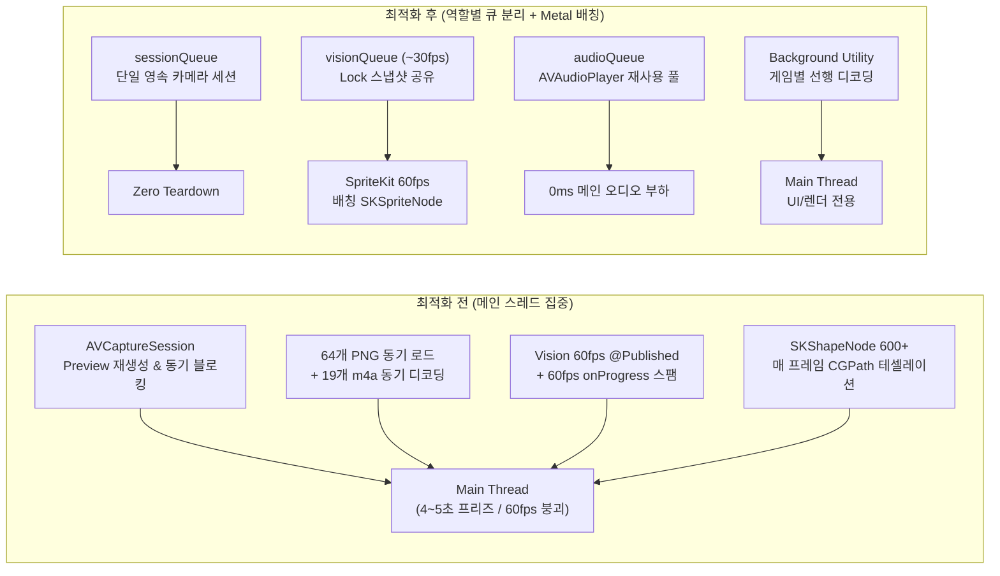

# 팡팡 프렌즈(PangPang Friends) iOS 성능 최적화 작업 내역서

- **작성일**: 2026-11-26
- **대상 플랫폼**: iOS 네이티브 (`SwiftUI + Apple Vision + SpriteKit + AVFoundation`)
- **대상 경로**: `ios/PangPangFriends/PangPangFriends/`
- **검증 환경**: `xcodebuild -sdk iphoneos -configuration Debug` (`** BUILD SUCCEEDED **`, 에러 0건, Swift 경고 0건)

---

## 1. 배경 및 증상

실기기(iPhone)에서 앱 실행 시 다음과 같은 체감 성능 저하가 발생했습니다.

1. **게임 선택 → 진입 시 4~5초 화면 멈춤(Freeze)**: 게임 카드를 선택해 진입하는 순간 앱이 장애가 난 것처럼 정지했다가 갑자기 다음 화면으로 넘어감.
2. **전반적인 프레임 드랍 및 입력 지연**: 카메라가 켜진 메뉴·인게임 환경에서 터치 반응과 모션 이펙트가 무겁게 끊김.
3. **고부하 구간(피버 타임·보스전·2인용) 히치**: 과일/풍선 연타, 손 트레일 다중 출력, 효과음 동시 재생 시 미세 버벅임 누적.

---

## 2. 아키텍처 병목 진단 요약

문제의 핵심은 **메인 스레드(UI/SpriteKit 60fps 렌더 루프)에 디스크 I/O, PNG 디코딩, AVFoundation 세션 제어, 오디오 초기화, 초당 30~60회의 불필요한 SwiftUI 상태 갱신, CPU 벡터 테셀레이션이 집중된 구조**였습니다.



---

## 3. 1차 최적화: 4~5초 진입 멈춤(Freeze) 및 핵심 메인스레드 블로킹 제거

| # | 문제 원인 | 수정 내용 | 대상 파일 |
|---|---|---|---|
| 1 | **게임 진입 시 64개 PNG 전체 동기 디코딩** (`preloadTextures()`가 모든 게임 에셋을 메인스레드에서 일괄 로드) | 게임별 필요한 텍스처만 온디맨드 로드하는 `preloadTextures(for:)`로 분리하고, Ready/Countdown 화면 진입 즉시 백그라운드에서 해당 게임 에셋만 선행 디코딩(`warmUpAssetsInBackground(for:)`) | `GameScene.swift`, `ContentView.swift` |
| 2 | **화면 전환마다 `CameraPreviewView` 파괴·재생성 + 메인스레드 `AVCaptureConnection` 조작** (`RotationCoordinator`가 메인스레드에서 `videoOutput` 연결을 수정해 AVFoundation 내부 락 데드락/수초 지연 유발) | `ContentView` 루트에 **단일 영속 `CameraPreviewView`**를 두고 Select → Ready → Countdown → InGame → Clear 전 구간 공유. `applyCaptureRotation`은 반드시 `sessionQueue`에서만 실행하도록 격리 | `ContentView.swift`, `HomeAndSelectViews.swift`, `VisionCameraManager.swift` |
| 3 | **매 프레임 `BundleImage` 디스크 I/O 반복 + 커스텀 폰트 첫 로드 지연** | `BundleImage`에 스레드 안전 `NSCache` 도입 + 앱 시작 시 홈/메뉴 이미지와 `Jua-Regular` 폰트를 백그라운드 워밍업 | `Models.swift`, `ContentView.swift` |
| 4 | **`SoundEngine` 메인스레드 동기 I/O** (`AVAudioSession` 활성화, 19개 `.m4a` 로드, BGM/SFX 생성이 메인스레드에서 실행) | 전용 직렬 큐(`pp.audio.queue`)를 도입해 세션 구성·프리로드·BGM·합성 SFX를 전부 백그라운드로 오프로딩 | `SoundEngine.swift` |
| 5 | **인게임 중 Vision → SwiftUI `@Published` 60fps 재렌더링 폭풍** (`players`/`airCursor`가 매 프레임 SwiftUI 뷰 트리 전체를 재평가) | `UIPublishMode`(`.none` / `.cursorOnly` / `.readyAndCursor`)와 `poseLock` 기반 `snapshotPlayers()` 도입. 인게임 중 SwiftUI 퍼블리시를 완전 차단하고 `GameScene`이 스냅샷을 직접 읽기. Vision 추론은 ~30fps(`minVisionInterval = 0.032`)로 안정 제한 | `VisionCameraManager.swift`, `ContentView.swift`, `GameScene.swift` |
| 6 | **SwiftUI `PreferenceKey` 무한 레이아웃 루프 & 과도한 텍스트 외곽선 뷰** (`StrokedJuaText`가 25개 `Text` 중첩) | `HandTargetBoundsKey` / `SelectTargetBoundsKey` 변경 시 값 동등성(`if bounds != ...`) 가드 추가. `StrokedJuaText`를 25개 → 9개(8방향 + 중앙) + `compositingGroup()`으로 축소 | `ContentView.swift`, `HomeAndSelectViews.swift` |

---

## 4. 2차 심층 최적화: 60fps 핫 루프·GPU 배칭·스레드 안전성 마감

1차 수정 후 전 파일을 60fps 핫 루프와 동시성 관점에서 재검토해 추가로 발견한 **6개 실측 병목 및 레이스 컨디션**을 해결했습니다.

| # | 발견한 병목 / 버그 | 해결 방법 | 기대 효과 | 대상 파일 |
|---|---|---|---|---|
| 1 | **인게임 60fps `onProgress` 메인스레드 디스패치 스팸** (`fruit`, `jungle`, `mole`, `balance`가 매 프레임 동일한 진행도를 `DispatchQueue.main.async`로 전송) | `GameScene`에 `reportProgress(_:_:)` / `reportScore(_:)` 중복 제거 레이어 추가 + `ContentView` 값 변경 가드 | 인게임 초당 60회 불필요한 클로저 할당·메인큐 디스패치·SwiftUI Diff 완전 제거 | `GameScene.swift`, `ContentView.swift` |
| 2 | **`SKShapeNode` CPU 테셀레이션 & Metal 드로우콜 폭발** (손 트레일 144개 매 프레임 `CGMutablePath` 재생성, 버스트 파티클 최대 200개, 비눗방울 이중 노드 최대 160개, 과즙 7개/타격, 컨페티 100개, 정적 테두리 매 프레임 경로 재생성) | 5종 공유 GPU 텍스처(`trailCapsuleTex`, `starParticleTex`, `dropletParticleTex`, `soapBubbleTex`, `confettiTex`) 1회 사전 베이크 후 `SKSpriteNode` 배칭으로 전환. 정적 `CGPath`(`feverBorder`, `clubBorder`, `discoString`), 보스 HP바, 진행 링(`CircularMoveBadge` 등) 및 텍스처 대입에 변경 감지 캐시 적용 | 초당 최대 **8,640회 CPU 스트로크 테셀레이션 → 0회**, 파티클/트레일 Metal 드로우콜 대폭 압축 | `GameScene.swift` |
| 3 | **인게임 중 25Hz 에어커서 타이머 상시 동작 & 유휴 `@State` 덮어쓰기** | `syncGlobalAirCursorLoop()` 도입으로 `.inGame`·`.home`·`.countdown`에서는 `globalAirTimer`를 완전 정지. `StageSelectView`의 유휴 틱 `@State` 중복 대입 제거 + 카운트다운 재진입 토큰(`countdownToken`) 방어 | 게임 플레이 중 25Hz 백그라운드 UI 타이머 웨이크업 **0회** | `ContentView.swift`, `HomeAndSelectViews.swift` |
| 4 | **카메라/비전 스레드 레이스 컨디션** (`visionQueue`가 메인스레드 `@Published airCursor`를 직접 읽기, 메인스레드 `session.isRunning` 직접 조회, `stopCamera()` 직후 재시작 경합, `viewSize` 비동기 접근) | `visionQueue` 전용 `internalAirCursor` 분리, `viewSize`에 `poseLock` 적용, `sessionQueue` 전용 `desiredCameraRunning` 플래그로 `start`/`stopCamera` 직렬화 | 스레드 경합 제거 및 홈↔선택 빠른 왕복 시 검은 화면 정지 버그 예방 | `VisionCameraManager.swift` |
| 5 | **지연 PNG 압축 해제 & CoreText 속성 매 타격 재할당** (`UIImage(contentsOfFile:)`는 첫 드로우 때 메인스레드에서 압축 해제됨, `stickerAttributedText`가 매번 `UIFont`·`NSShadow`·`NSAttributedString` 생성) | 백그라운드 워밍업 시 `preparingForDisplay()`로 실제 픽셀 디코딩까지 완료 후 캐시. `AppFont`에 `fontCache` 및 `stickerCache`(`NSCache`, 160개) 추가 | 게임 시작 첫 프레임 디코딩 히치 제거 + 연타 플로팅 텍스트 생성 비용 최소화 | `Models.swift` |
| 6 | **효과음 연타 시 매번 `AVAudioPlayer(data:)` 재생성 & 메인스레드 경유** | `audioQueue` 내 키별 최대 4보이스 재사용 풀(`sfxPlayerPool`) 도입. 다중 음표 효과음의 `DispatchQueue.main.asyncAfter`를 `audioQueue.asyncAfter`로 교체 | 피버 타임 연타 시 AAC 디코더 반복 초기화 제거 + 메인스레드 왕복 0회 | `SoundEngine.swift` |

---

## 5. 변경 파일 통계 (`git diff --stat`)

| 파일 | 변경량 | 핵심 역할 |
|---|---:|---|
| [GameScene.swift](file:///Users/kwon/codes/yong-workspace/games/kids1/ios/PangPangFriends/PangPangFriends/GameScene.swift) | `+407 / -173` | 온디맨드 텍스처 로딩, `snapshotPlayers()` 연동, `SKShapeNode → SKSpriteNode` 배칭, `onProgress`/경로/텍스처 캐싱 |
| [VisionCameraManager.swift](file:///Users/kwon/codes/yong-workspace/games/kids1/ios/PangPangFriends/PangPangFriends/VisionCameraManager.swift) | `+156 / -46` | ~30fps 추론 제한, `UIPublishMode` & `poseLock` 스냅샷, `sessionQueue` 직렬화, `internalAirCursor` 스레드 분리 |
| [SoundEngine.swift](file:///Users/kwon/codes/yong-workspace/games/kids1/ios/PangPangFriends/PangPangFriends/SoundEngine.swift) | `+97 / -58` | 전용 `audioQueue` 오프로딩, `sfxPlayerPool` 재사용 풀, 메인스레드 타이머 경유 제거 |
| [ContentView.swift](file:///Users/kwon/codes/yong-workspace/games/kids1/ios/PangPangFriends/PangPangFriends/ContentView.swift) | `+107 / -45` | 단일 영속 `CameraPreviewView`, 게임별 백그라운드 워밍업, `globalAirTimer` 수명주기 제어, `PreferenceKey`/콜백 가드, `StrokedJuaText` 경량화 |
| [Models.swift](file:///Users/kwon/codes/yong-workspace/games/kids1/ios/PangPangFriends/PangPangFriends/Models.swift) | `+103 / -24` | `BundleImage` `NSCache` + `preparingForDisplay()` 디코딩, `AppFont` 폰트·CoreText 캐시 |
| [HomeAndSelectViews.swift](file:///Users/kwon/codes/yong-workspace/games/kids1/ios/PangPangFriends/PangPangFriends/HomeAndSelectViews.swift) | `+15 / -11` | 중복 카메라 프리뷰 제거, `PreferenceKey` 및 유휴 에어커서 `@State` 대입 가드 |

---

## 6. 빌드 및 검증 결과

- **실기기 타깃 빌드**:
  ```bash
  xcodebuild -project ios/PangPangFriends/PangPangFriends.xcodeproj \
    -target PangPangFriends -sdk iphoneos -configuration Debug \
    CODE_SIGNING_ALLOWED=NO build
  ```
- **결과**: `** BUILD SUCCEEDED **` (컴파일 에러 0건, Swift 경고 0건)
- **산출물 정리**: `ios/PangPangFriends/build` 임시 빌드 폴더 삭제 완료
