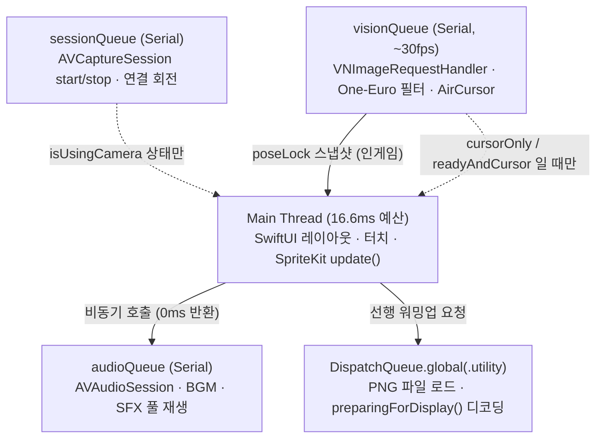

# 팡팡 프렌즈(PangPang Friends) 성능 최적화 개발 지침서

본 문서는 **실시간 카메라 포즈 인식 + 60fps 모션 게임**을 iOS(`SwiftUI + Vision + SpriteKit + AVFoundation`)와 웹(`PixiJS + MediaPipe`)에서 개발·확장할 때 **프리즈(Freeze), 프레임 드랍, 스레드 레이스 컨디션을 원천 방지**하기 위한 표준 개발 패턴을 정의합니다.

---

## 1. 핵심 설계 철학: 스레드 & 책임 격리

메인 스레드는 오직 **UI 레이아웃·터치 이벤트·SpriteKit 60fps 렌더 제출**만 담당해야 합니다. 무거운 작업은 반드시 전용 큐에 고정합니다.



### 절대 금지 규칙 (Zero-Tolerance Rules)
1. **메인 스레드에서 디스크/미디어/AVFoundation 동기 I/O 금지**: `Data(contentsOf:)`, `UIImage(contentsOfFile:)` 대량 로딩, `AVAudioSession.setActive`, `AVAudioPlayer(contentsOf:)`, `AVCaptureSession.startRunning/stopRunning` 호출 금지.
2. **인게임 60fps 루프에서 SwiftUI `@Published`/`@State` 주기적 갱신 금지**: 매 프레임 HUD를 갱신하지 말고 값이 실제로 변했을 때만 이벤트 기반으로 전송.
3. **60fps 루프 내부에서 `SKShapeNode` 생성 또는 `CGPath` 매 프레임 재생성 금지**: 동적 파티클·트레일·이펙트는 사전 생성한 `SKTexture` 기반 `SKSpriteNode`로 배칭.
4. **크로스 스레드 `@Published` 직접 읽기/쓰기 금지**: 백그라운드 큐 상태는 해당 큐 전용 변수로 유지하거나 `NSLock`으로 보호.

---

## 2. 영역별 개발 패턴 (Do & Don't)

### 2-1. 카메라 & Apple Vision 파이프라인 (`VisionCameraManager`)

#### ✅ 해야 할 패턴 (Do)
- **단일 영속 `CameraPreviewView` 유지**: 앱 루트(`ContentView`)에 1개만 마운트해 화면 전환(`Select → Ready → Countdown → InGame → Clear`) 동안 재사용합니다.
- **모든 `AVCaptureSession` / `videoOutput.connection` 조작은 `sessionQueue` 직렬화**: `desiredCameraRunning` 같은 큐 전용 플래그로 `start`/`stop` 경합을 막고, 메인 스레드에서 `session.isRunning`을 직접 읽지 않습니다.
- **Vision 추론 FPS 상한 설정**: 카메라는 60fps로 들어오더라도 Vision 추론은 ~30fps(`minVisionInterval = 0.032`)로 제한해 Metal GPU와 발열 여유를 확보합니다.
- **화면 상태별 퍼블리시 모드 분리 (`UIPublishMode`)**:
  - `.inGame`: `.none` (SwiftUI 퍼블리시 0회, SpriteKit이 `snapshotPlayers()`를 `poseLock`으로 직접 조회)
  - `.select`, `.clear`, 설정/일시정지 모달: `.cursorOnly` (좌표 변화가 임계치 이상일 때만 `airCursor` 발행)
  - `.ready`, `.countdown`: `.readyAndCursor`
- **큐 전용 상태 분리**: `computeAirCursor`처럼 `visionQueue`에서 도는 로직은 `@Published airCursor`를 읽지 않고 `internalAirCursor`만 읽고 갱신한 뒤 결과값만 메인으로 전달합니다.

#### ❌ 피해야 할 패턴 (Don't)
```swift
// ❌ BAD: 메인스레드에서 session.isRunning 조회 + 화면마다 CameraPreviewView 재생성
if isUsingCamera && session.isRunning { return }

// ❌ BAD: visionQueue 내부에서 메인스레드 @Published 프로퍼티 직접 읽기
let moveDist = hypot(mx - self.airCursor.x, my - self.airCursor.y)
```

---

### 2-2. SpriteKit 60fps 렌더링 & VFX (`GameScene`)

#### ✅ 해야 할 패턴 (Do)
- **파티클·트레일·과즙·컨페티는 1회 사전 베이크 `SKTexture` + `SKSpriteNode` 사용**:
  - 흰색 도형 텍스처를 `UIGraphicsImageRenderer`로 최초 1회 생성해 `lazy var`로 캐시합니다.
  - 색상은 `node.color = ...; node.colorBlendFactor = 1.0`, 발광은 `blendMode = .add`로 처리합니다.
  - **동일 텍스처·동일 블렌드모드 노드를 연속 추가**하면 `ignoresSiblingOrder = false` 상태에서도 SpriteKit이 Metal 드로우콜을 자동 배칭합니다.
- **라인/트레일 세그먼트는 캡슐 텍스처 변환으로 대체**:
  ```swift
  // ✅ GOOD: 0 CGMutablePath 할당, 0 CPU 테셀레이션
  let mid = CGPoint(x: (p0.x + p1.x) * 0.5, y: (p0.y + p1.y) * 0.5 + band.offsetY)
  seg.position = mid
  seg.zRotation = atan2(p1.y - p0.y, p1.x - p0.x)
  seg.xScale = (hypot(p1.x - p0.x, p1.y - p0.y) + width) / texWidth
  seg.yScale = width / texHeight
  ```
- **불가피한 `SKShapeNode` 게이지/아크는 변경 양자화 캐싱**:
  - 화면 크기 의존 테두리(`feverBorder`, `clubBorder`): `if size != lastBorderSize`일 때만 `CGPath` 재생성.
  - 진행 바/원형 게이지: `let step = Int((ratio * 120).rounded())`로 정수 스텝이 바뀔 때만 `CGPath` 재생성.
- **텍스처 재할당 가드**: `if sp.texture !== tex { sp.texture = tex }`로 불필요한 상태 갱신을 막습니다.
- **HUD 콜백 중복 제거**: `reportScore(_:)` / `reportProgress(_:_:)`를 통해서만 SwiftUI에 이벤트를 전달합니다.

#### ❌ 피해야 할 패턴 (Don't)
```swift
// ❌ BAD: 60fps update() 안에서 매 프레임 CGMutablePath 생성 (초당 수천 회 테셀레이션)
let p = CGMutablePath()
p.move(to: p0); p.addLine(to: p1)
seg.path = p

// ❌ BAD: 값이 안 바뀌어도 매 프레임 메인스레드 HUD 갱신
onProgress?(min(9, Int((zenElapsed / zenDuration) * 9.0)), 9)
```

---

### 2-3. 에셋 로딩 & 텍스트 렌더링 (`Models`)

#### ✅ 해야 할 패턴 (Do)
- **게임별 온디맨드 로딩 + 선행 백그라운드 디코딩**:
  - 새 게임을 추가할 때는 반드시 `GameScene.textureNames(for:)`에 해당 게임에서 쓰는 이미지만 등록합니다.
  - 게임 선택 → Ready 화면 진입 시 `warmUpAssetsInBackground(for:)`가 백그라운드에서 자동 호출되어 **실제 게임 진입 시 0ms 로드**를 보장합니다.
- **백그라운드 디코딩 시 `preparingForDisplay()` 활용**: `UIImage(contentsOfFile:)`는 지연 디코딩이므로, 백그라운드 워밍업에서는 `img.preparingForDisplay()`를 호출해 GPU 업로드 직전 비트맵까지 미리 풀어 캐시합니다.
- **반복되는 CoreText 스티커 텍스트 캐싱**: `AppFont.stickerAttributedText(...)`처럼 `NSMutableParagraphStyle`/`NSShadow`/`NSAttributedString`을 조합하는 헬퍼는 `NSCache`로 캐시해 재사용합니다.
- **SwiftUI 외곽선 텍스트 경량화**: `StrokedJuaText`는 최대 8방향 + 중앙(9개) + `.compositingGroup()`으로 유지하며, 인게임 60fps 영역에서는 SwiftUI 대신 SpriteKit `SKLabelNode`를 사용합니다.

---

### 2-4. 오디오 파이프라인 (`SoundEngine`)

#### ✅ 해야 할 패턴 (Do)
- **전용 직렬 큐(`audioQueue`)에서 모든 오디오 상태 관리**: `AVAudioSession`, `AVAudioEngine`, `AVAudioPlayer`, `bgmAllowed` 상태를 한 큐에서 일관되게 다룹니다.
- **빈번한 효과음은 `AVAudioPlayer` 재사용 풀 사용**: 키별 2~4개의 플레이어를 풀링해 유휴 인스턴스의 `currentTime = 0` 후 재재생합니다(매 타격마다 `AVAudioPlayer(data:)` 재생성 금지).
- **지연 화음/연속 효과음은 `audioQueue.asyncAfter` 사용**: 메인 스레드를 거치지 않고 오디오 큐에서 바로 스케줄링합니다.
- **생명주기 게이트(`bgmAllowed`) 엄수**: 인게임 이탈·백그라운드 전환(`scenePhase != .active`) 시 즉시 BGM을 정지합니다.

---

### 2-5. SwiftUI 상태 관리 & 타이머 (`ContentView`, `HomeAndSelectViews`)

#### ✅ 해야 할 패턴 (Do)
- **타이머는 필요한 화면에서만 동작**: `globalAirTimer`처럼 주기적으로 도는 타이머는 해당 UI가 활성화된 화면/모달에서만 시작하고, 인게임(`.inGame`) 진입 즉시 `invalidate()`합니다.
- **타이머/콜백 내 `@State` 대입 전 값 비교 가드**:
  ```swift
  // ✅ GOOD: 이미 같은 값이면 SwiftUI 뷰 무효화 0회
  if globalDwell != 0 { globalDwell = 0 }
  if hoveredGlobalTarget != nil { hoveredGlobalTarget = nil }
  ```
- **`PreferenceKey` 역전파 루프 방지**: `.onPreferenceChange(...)`에서는 반드시 `if bounds != handTargets { handTargets = bounds }`로 동등성 비교 후 상태를 갱신합니다.
- **비동기 지연 시퀀스 취소 토큰**: 카운트다운처럼 `asyncAfter` 체인이 있는 흐름은 `countdownToken`을 증가시켜 뒤로가기 후 재진입 시 이전 타이머가 끼어들지 못하게 막습니다.

---

### 2-6. 웹 플랫폼 (`PixiJS + MediaPipe`) 공통 원칙

웹 버전(`src/`)을 확장할 때도 동일한 최적화 원칙을 일관되게 적용합니다.

- **렌더 루프와 포즈 추론 분리**: `requestAnimationFrame` 60fps 렌더를 유지하고 MediaPipe 추론은 프레임 스킵/비동기 처리해 캔버스 드로우를 블로킹하지 않습니다.
- **PixiJS Graphics 남용 금지**: 반복 생성되는 파티클/별/물방울은 `PIXI.Sprite` + 공유 `Texture`로 풀링하고, `PIXI.Graphics.clear()`를 매 프레임 수십 개씩 호출하지 않습니다.
- **DOM 조작 최소화**: 점수·진행도·콜아웃 DOM `textContent`/`style`은 값이 실제로 바뀐 프레임에만 갱신합니다.
- **오디오 파일 사전 디코딩**: Web Audio `AudioBuffer`를 최초 1회 디코딩해 캐시하고, 타격마다 `AudioBufferSourceNode`만 가볍게 생성합니다.

---

## 3. 새 게임 / 기능 추가 시 PR 전 성능 체크리스트

새로운 미니게임, 이펙트, 모달, 오디오를 추가한 뒤 머지/빌드 전에 아래 항목을 반드시 확인합니다.

- [ ] **에셋 온디맨드 등록**: 새 PNG 파일이 `GameScene.textureNames(for:)`의 해당 게임 케이스에만 추가되었는가? (전역 일괄 로드 금지)
- [ ] **60fps 루프 할당 점검**: `update(_:)` 및 하위 `update*Game` 메서드 안에 `SKShapeNode(...)`, `CGMutablePath()`, `UIImage(...)`, `AVAudioPlayer(...)` 생성이 없는가?
- [ ] **콜백·상태 중복 제거**: `onProgress` / `onScore` / `@State` / `PreferenceKey`가 값이 바뀔 때만 호출되는가?
- [ ] **인게임 백그라운드 타이머 0건**: 플레이 도중 불필요한 SwiftUI `Timer`나 `UIPublishMode != .none`이 남아있지 않은가?
- [ ] **스레드 경계 점검**: `sessionQueue` / `visionQueue` / `audioQueue`에서 `@Published` 프로퍼티를 직접 읽거나 쓰지 않는가?
- [ ] **실기기 타깃 빌드 검증**: `xcodebuild -sdk iphoneos ... build`에서 에러 0건, Swift 경고 0건을 확인했는가?
- [ ] **실기기 체감 점검**: 게임 카드 선택 직후 멈춤 없이 즉시 Ready 화면에 진입하고, 피버 타임·2인용 동시 입력에서도 60fps가 유지되는가?
