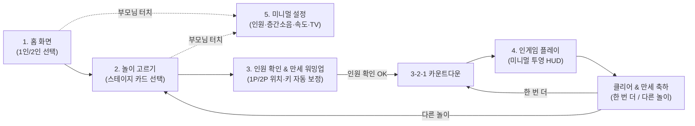
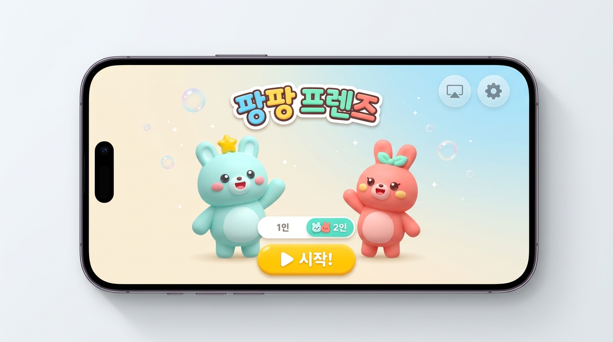
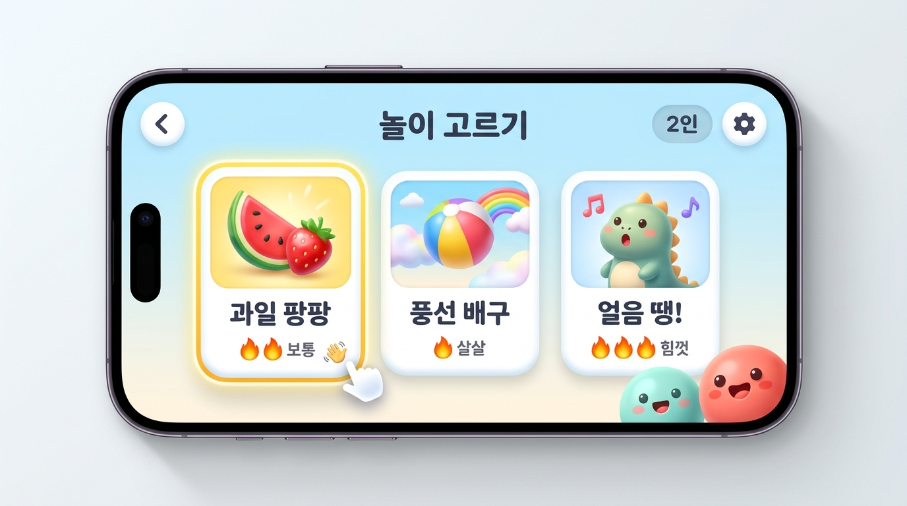
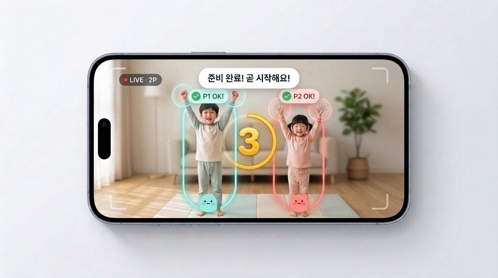
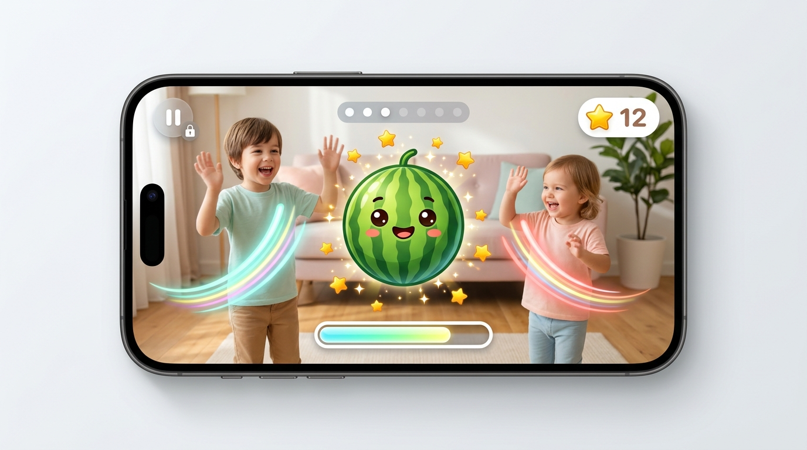
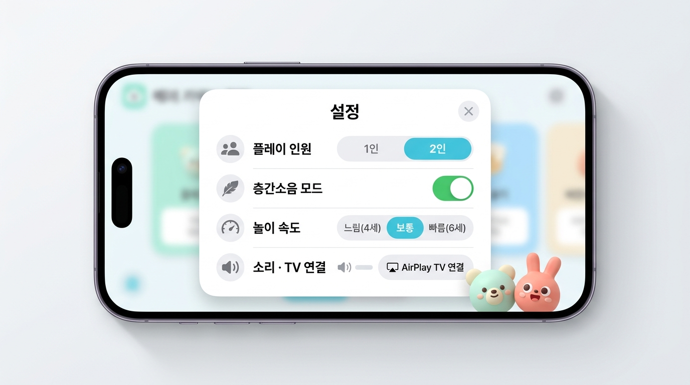

# 「팡팡 프렌즈」 아이폰 기준 UI/UX 상세 설계서

> **타겟 환경**: iPhone 가로 모드(Landscape) 단독 플레이 및 **AirPlay / HDMI 거실 TV 미러링 투영** 동시 대응  
> **타겟 유저**: 4세·6세 유아(주 플레이어) + 부모(초기 세팅 및 모드 전환)  
> **핵심 콘셉트**: Nintendo Wii Sports의 직관적 거실 놀이 경험 + 레디&루디(Redi & Ludi)의 비접촉 유아 UX + Apple HIG 미니멀리즘  
> **샘플 데모 영상**: [`./fruit_pop_2p_sample.mp4`](./fruit_pop_2p_sample.mp4)

---

## 1. 벤치마킹 및 핵심 UX 원칙

카메라로 아이들의 모습이 화면에 직접 투영되기 때문에, **UI가 화면의 15~20% 이상을 가리면 몰입감이 급격히 떨어집니다.** 아래 4개 레퍼런스의 장점만 결합해 극단적으로 심플하게 설계합니다.

| 벤치마크 대상 | 차용할 핵심 UX 포인트 | 본 앱 적용 방식 |
| :--- | :--- | :--- |
| **Nintendo Wii Sports** | 2~3m 거리에서도 읽히는 굵은 타이포, 1초 만에 이해되는 카드 UI, 호버링 포인터 피드백 | 둥근 대형 카드 3개, 손 커서 링(1.5초 유지 시 선택), 경쾌한 타격 사운드 |
| **레디&루디 (Redi & Ludi)** | 비접촉 조작, 운동 강도(불꽃) 3단계 표기, 1인/2인 즉시 전환, 광고·로그인 배제 | 카드 하단 `🔥 살살 / 보통 / 힘껏` 표기, 홈 화면에서 바로 `1인/2인` 전환 |
| **Ring Fit Adventure** | 게임 시작 전 짧은 자세/거리 보정(캘리브레이션)을 놀이처럼 자연스럽게 유도 | 인원 확인 화면에서 **"여기에 서서 만세!"**로 3초 만에 키·위치 자동 보정 |
| **Just Dance Kids** | 실패/게임오버 없음, 텍스트 대신 시각적 실루엣과 컬러로 역할 구분 | P1(민트) / P2(코랄) 고정 컬러 시스템, 별 3개·만세 축하 엔딩 |

### 마스코트 캐릭터 & 컬러 시스템
* **모모 (Momo · P1 / 왼쪽)**: 민트 블루 둥근 곰·토끼 마스코트 + 노란 별 머리장식 (`#48D1CC`)
* **포포 (Popo · P2 / 오른쪽)**: 코랄 핑크 둥근 곰·토끼 마스코트 + 민트 리본 (`#FF7F8A`)
* **아이폰 Safe Area 대응**: 가로 모드에서 왼쪽 **Dynamic Island(또는 노치)** 영역은 터치 버튼·중요 HUD를 배치하지 않고 여백으로 비워, TV 미러링 시에도 화면 비율이 어긋나지 않게 유지합니다.

---

## 2. 전체 사용자 흐름 (User Flow)

---

## 3. 핵심 UX 결정: 초반 인원 확인 (Ready Check)

* **필요성**: 카메라 화각(전신 거리) 확보 + 4세·6세 키 차이/좌우 영역 자동 보정 + 놀이 시작 전 집중 유도.
* **단순화 원칙**:
  1. 별도 버튼 없이 영역 안에 서서 손을 들면 자동 `P1 OK! / P2 OK!` → `3-2-1` 카운트다운 자동 진입.
  2. 부모님이 화면을 탭해 **즉시 시작(Skip)** 가능.
  3. 같은 게임 **다시 하기** 시 인원 확인 생략 후 바로 `3-2-1` 진입.

---

## 4. 화면별 상세 UI/UX 설계 & 아이폰 시안

### 화면 1. 홈 / 시작 화면

* 모모 & 포포 마스코트, `1인/2인` 빠른 전환 토글, 대형 `▶ 시작!` 버튼, 우상단 AirPlay·설정 아이콘.

### 화면 2. 놀이 고르기 (스테이지 선택)

* Wii 스타일 대형 카드 3종 (`과일 팡팡`, `풍선 배구`, `얼음 땡!`), 운동 강도 불꽃 아이콘(`살살/보통/힘껏`), 터치 및 비접촉 손 호버(1.5초) 선택 지원.

### 화면 3. 인원 확인 & 3-2-1 카운트다운

* 실시간 거실 카메라 화면 + P1(민트) / P2(코랄) AR 캡슐 + 손 추적 링 + 중앙 골드 링 `3-2-1` 카운트다운.

### 화면 4. 인게임 미니멀 투영 HUD

* 화면 85% 이상을 아이들과 오브젝트에 양보. 좌상단 부모 잠금 일시정지(2초 홀드), 상단 중앙 진행 도트, 우상단 별 카운터만 배치.

### 화면 5. 미니멀 부모님 설정 화면

* 단 1장 카드, 4개 핵심 옵션: `플레이 인원(1인/2인)`, `층간소음 모드(ON/OFF)`, `놀이 속도(느림 4세 / 보통 / 빠름 6세)`, `소리 · TV 연결`.
